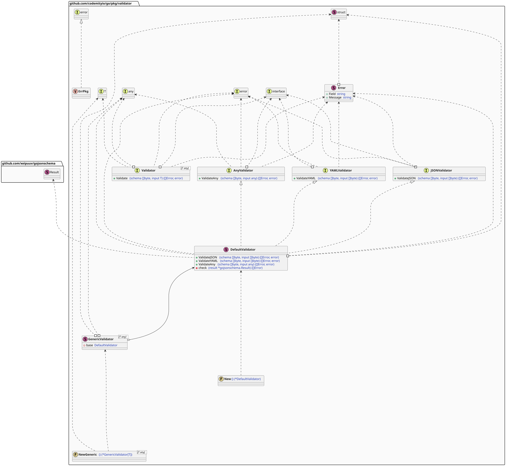
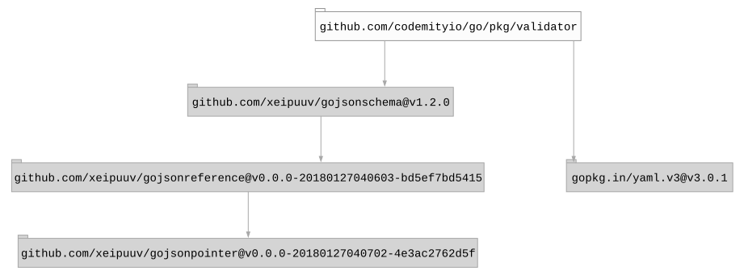

# `validator`

## Table of contents

- [Summary](#summary)
- [Input types](#input-types)
- [Design](#design)
- [Dependencies](#dependencies)

## Summary

This package provides JSON schema-based validation for **JSON**, **YAML**, and arbitrary Go values.

## Input types

The following input types are supported.

- `[]byte` - as **JSON**
- `[]byte` - as **YAML**
- `any`
- `T` - via the generic `Validator[T]` interface (`NewGeneric[T]()`), where `[]byte` and `json.RawMessage` are treated
  as raw **JSON** and any other type is validated as a Go value (using its `json` tags)

## Design

## Dependencies

